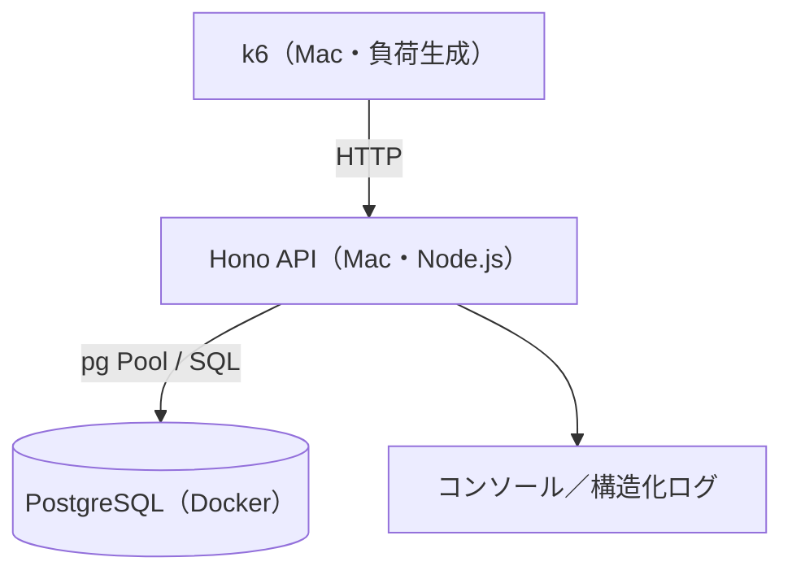
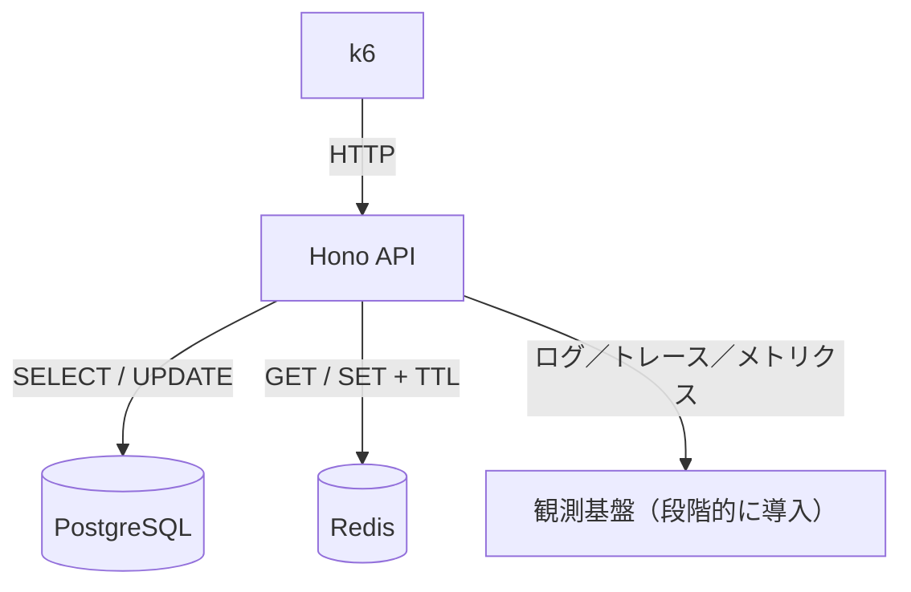

# backend-performance-lab

**バックエンドの性能問題を「再現 → 計測 → 調査 → 仮説 → 改善 → 再計測」する学習リポジトリ。**

SQL実行計画、DBコネクションプール、トランザクション／ロック、Redisキャッシュ、ログ・トレース、負荷試験を、同じ小さなAPIで段階的に学ぶ。

> **Phase 0 実装済み。** 以降のPhaseはロードマップに沿って進める。

## 目指す状態

- SQLの実行計画を根拠に遅延原因を説明できる。
- SQL実行時間、DB接続待ち、ロック待ちを切り分けられる。
- Redisなどの対策について、効果と整合性・運用コストを比較できる。
- k6とログ・メトリクスで同じ条件の改善前後を比較できる。
- 調査の証拠、却下案を含む設計判断をMarkdownに残せる。

## 構成

| 役割 | 技術 | 起動方法 | 導入時期 |
| --- | --- | --- | --- |
| API | Hono + TypeScript + Node.js 24 | Macで直接起動 | Phase 0 |
| DB | PostgreSQL | Docker Compose（推奨。ローカル導入も可） | Phase 0 |
| 負荷試験 | k6 | Macで直接実行 | Phase 0 |
| キャッシュ | Redis | Docker Compose | Phase 3 |
| 可観測性 | 構造化ログ、OpenTelemetry等 | 順次追加 | Phase 4 |

**Dockerは必須ではない**が、実験用PostgreSQLを気軽に初期化できるためおすすめ。APIやk6までDockerに入れる必要はない。

### システム構成図（Phase 0）



### 将来の構成（Phase 3〜4以降）



詳細：[docs/architecture.md](docs/architecture.md)

## ディレクトリ

```text
backend-performance-lab/
├── README.md
├── AGENTS.md                     # AIに渡す作業ルール
├── .env.example
├── .gitignore
├── compose.yaml                  # Phase 0: PostgreSQLのみ
├── package.json                  # Phase 0で生成
├── src/
│   ├── index.ts                  # API エントリ（Phase 0）
│   └── db.ts                     # pg Pool（Phase 0）
├── sql/
│   └── schema.sql                # ordersテーブル（Phase 0）
├── scripts/
│   └── seed.ts                   # ダミーデータ（Phase 0）
├── load-tests/
│   └── orders.js                 # k6シナリオ（Phase 0）
└── docs/
    ├── architecture.md
    ├── roadmap.md
    └── experiments/
        ├── README.md             # 実験記録ルール
        ├── 01-sql-performance.md
        ├── 02-connection-pool.md
        └── 03-redis-cache.md
```

## 前提

- Node.js 24（`.nvmrc` あり。`nvm use` 推奨）
- Docker Desktop（PostgreSQL用）
- k6（負荷試験。未導入なら `brew install k6`）

## 起動／初期化／シード／計測

```bash
# 0. 依存関係
cp .env.example .env
npm install

# 1. PostgreSQL（Docker）
npm run db:up
# 初回は healthcheck が green になるまで数秒待つ
docker compose ps

# 2. スキーマ適用 + 少量シード
npm run db:init

# 3. API 起動（別ターミナル）
npm run start
# 開発時の自動再起動: npm run dev

# 4. 動作確認
curl -s http://127.0.0.1:3000/health
curl -s "http://127.0.0.1:3000/orders?userId=123"

# 5. k6（API起動中に）
npm run load:orders

# 6. 実行計画の確認例（コンテナ内 psql）
docker compose exec db psql -U lab -d performance_lab -c \
  "EXPLAIN (ANALYZE, BUFFERS)
   SELECT id, user_id, total, created_at
   FROM orders
   WHERE user_id = 123
   ORDER BY created_at DESC
   LIMIT 20;"
```

### よく使うコマンド

| 目的 | コマンド |
| --- | --- |
| DB起動 | `npm run db:up` |
| DB停止 | `npm run db:down` |
| データごと作り直し | `npm run db:reset` → 起動後に `npm run db:init` |
| スキーマのみ再適用 | `npm run db:schema` |
| シードのみ再実行 | `npm run db:seed` |
| API起動 | `npm run start` |
| k6 | `npm run load:orders` |

環境変数は `.env`（`.env.example` をコピー）。`DATABASE_URL` と `DB_POOL_MAX` で接続先とプール上限を変更できる。

## 進め方：次の一歩

1. 上記コマンドで `GET /health` → `GET /orders` → k6 を通す。
2. 計測条件を固定して記録し、Phase 1（SQLと実行計画）へ進む。
3. Redis／Grafana／OpenTelemetry はまだ入れない。

## Phase 0 の完成条件

- [x] `GET /health` が200で返る。
- [x] `orders` のデータをAPIから取得できる。
- [x] `EXPLAIN (ANALYZE, BUFFERS)` を実行できる。
- [x] k6でローカルAPIに負荷をかけ、p95と失敗率を確認できる。
- [x] 実行コマンドがREADMEにあり、別の環境で再現できる。

## 学習のルール

- **計測前に最適化しない。** まず仮説と基準値を保存する。
- 実験ごとにできるだけ変更点を一つに絞る。
- データ件数、環境、インデックス、負荷条件、結果を残す。
- キャッシュの導入やプール上限変更を万能策として扱わない。
- k6は自分のローカル／許可された環境だけに使用する。
- 実験は `docs/experiments/` に記録する。

## ドキュメント

- [12週間の学習ロードマップ](docs/roadmap.md)
- [構成図と設計方針](docs/architecture.md)
- [実験記録の書き方](docs/experiments/README.md)
