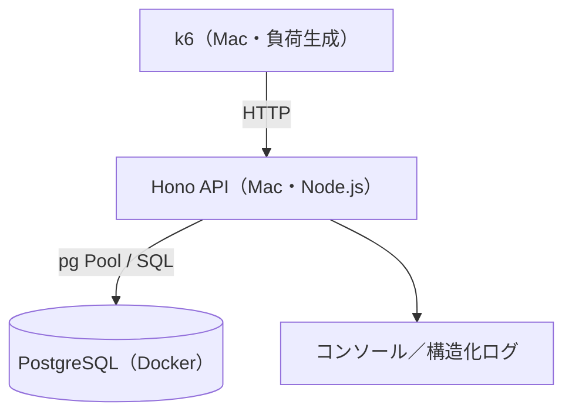
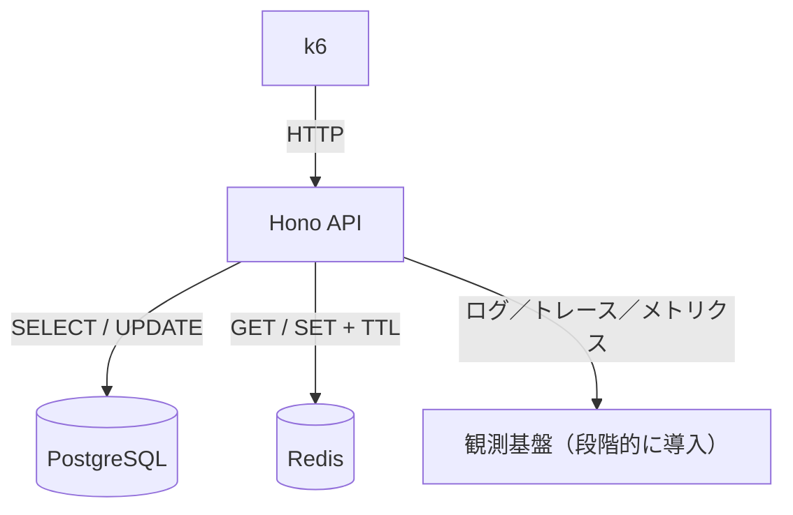

# backend-performance-lab

**バックエンドの性能問題を「再現 → 計測 → 調査 → 仮説 → 改善 → 再計測」する学習リポジトリ。**

SQL実行計画、DBコネクションプール、トランザクション／ロック、Redisキャッシュ、ログ・トレース、負荷試験を、同じ小さなAPIで段階的に学ぶ。

> 現在は**実装開始前の設計スキャフォールド**。最初から全機能を実装せず、Phase 0から順に進める。

## 目指す状態

- SQLの実行計画を根拠に遅延原因を説明できる。
- SQL実行時間、DB接続待ち、ロック待ちを切り分けられる。
- Redisなどの対策について、効果と整合性・運用コストを比較できる。
- k6とログ・メトリクスで同じ条件の改善前後を比較できる。
- 調査の証拠、却下案を含む設計判断をMarkdownに残せる。

## 構成

| 役割 | 技術 | 起動方法 | 導入時期 |
| --- | --- | --- | --- |
| API | Hono + TypeScript + Node.js 24 | Macで直接起動 | Phase 0 |
| DB | PostgreSQL | Docker Compose（推奨。ローカル導入も可） | Phase 0 |
| 負荷試験 | k6 | Macで直接実行 | Phase 0 |
| キャッシュ | Redis | Docker Compose | Phase 3 |
| 可観測性 | 構造化ログ、OpenTelemetry等 | 順次追加 | Phase 4 |

**Dockerは必須ではない**が、実験用PostgreSQLを気軽に初期化できるためおすすめ。APIやk6までDockerに入れる必要はない。

### システム構成図（Phase 0）



### 将来の構成（Phase 3〜4以降）



詳細：[docs/architecture.md](docs/architecture.md)

## ディレクトリ

```text
backend-performance-lab/
├── README.md
├── AGENTS.md                     # AIに渡す作業ルール
├── .env.example
├── .gitignore
├── compose.yaml                  # Phase 0: PostgreSQLのみ
├── package.json                  # Phase 0で生成
├── src/
│   ├── index.ts                  # API エントリ（Phase 0）
│   └── db.ts                     # pg Pool（Phase 0）
├── sql/
│   └── schema.sql                # ordersテーブル（Phase 0）
├── scripts/
│   └── seed.ts                   # ダミーデータ（Phase 0）
├── load-tests/
│   └── orders.js                 # k6シナリオ（Phase 0）
└── docs/
    ├── architecture.md
    ├── roadmap.md
    └── experiments/
        ├── README.md             # 実験記録ルール
        ├── 01-sql-performance.md
        ├── 02-connection-pool.md
        └── 03-redis-cache.md
```

`src/`、`sql/`、`scripts/`、`load-tests/` はAIとの実装時に作成する。フォルダがまだなくても問題ない。

## 進め方：最初の1歩

1. GitHubで `backend-performance-lab` を作り、ここにあるドキュメントをpushする。
2. AIに [`AGENTS.md`](AGENTS.md) と [`docs/roadmap.md`](docs/roadmap.md) を読ませる。
3. **Phase 0だけ**実装してもらう。Redis／Grafana／OpenTelemetryにはまだ触れない。
4. `GET /health` → DB接続 → `GET /orders?userId=123` → k6 の順に動作確認。
5. 計測条件を固定して記録し、Phase 1で遅いSQLに挑戦する。

## Phase 0 の完成条件

- `GET /health` が200で返る（できればDB接続確認は別途明示）。
- `orders` のデータをAPIから取得できる。
- `EXPLAIN (ANALYZE, BUFFERS)` を実行できる。
- k6でローカルAPIに負荷をかけ、p95と失敗率を確認できる。
- 実行コマンドがREADMEに追記され、別の環境で再現できる。

## 学習のルール

- **計測前に最適化しない。** まず仮説と基準値を保存する。
- 実験ごとにできるだけ変更点を一つに絞る。
- データ件数、環境、インデックス、負荷条件、結果を残す。
- キャッシュの導入やプール上限変更を万能策として扱わない。
- k6は自分のローカル／許可された環境だけに使用する。
- 実験は `docs/experiments/` に記録する。

## ドキュメント

- [12週間の学習ロードマップ](docs/roadmap.md)
- [構成図と設計方針](docs/architecture.md)
- [実験記録の書き方](docs/experiments/README.md)
