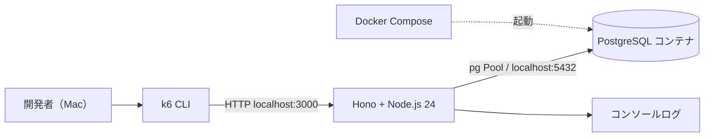
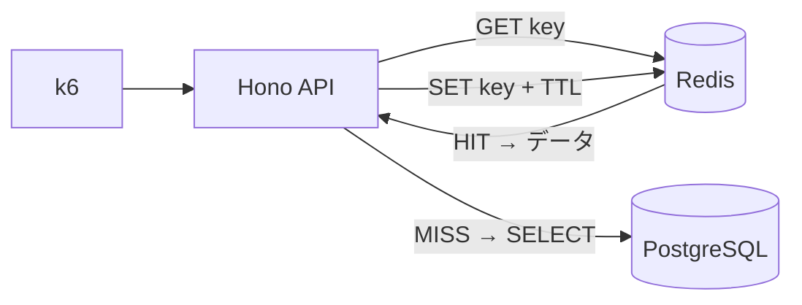
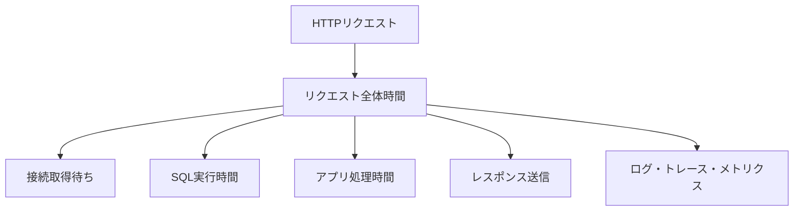

# アーキテクチャと設計判断

## Phase 0：最小構成

### データの流れ
1. k6が `GET /orders?userId=123` を呼ぶ。
2. Honoが入力を検証し、`pg.Pool` からDB接続を借りる。
3. PostgreSQLでSQLを実行し、結果をJSONで返す。
4. k6で所要時間、p95、失敗率を記録する。
5. SQLそのものは `EXPLAIN (ANALYZE, BUFFERS)` で別途調べる。

> **重要：** k6でAPIが遅いことがわかっても、それだけでSQLが原因とは断定できない。アプリ処理・接続取得待ち・SQL実行・レスポンス返却を切り分ける。

## Phase 3：Redis導入後

RedisはRead Throughが自動提供される前提ではなく、アプリでCache-Asideを実装する。更新時のキャッシュ削除、TTL、一斉MISS、Redis障害時の振る舞いを必ず実験する。

## Phase 4：観測ポイント

接続待ちとSQL実行時間は分けて測る。観測ツールの導入より先に、指標の意味と正しい計測範囲を決める。

## 技術選定メモ
- **Hono / TypeScript：** API実装の学習コストを抑える。
- **Node.js上の `pg.Pool`：** 接続プールの実験をシンプルに始められる。Java/HikariCPとは挙動や設定項目が異なる。
- **PostgreSQL：** `EXPLAIN` や `pg_stat_activity` を調査に利用する。
- **Docker：** PostgreSQLの再作成を簡単にするための任意の選択。性能測定値にはコンテナ・Macの負荷も影響する。
- **k6：** HTTPレベルで負荷を作る。仮想ユーザー数と実際の同時進行リクエスト数は同義ではない。

## 安全・再現性
- ComposeのDBポートは `127.0.0.1` にのみ公開する。
- テストデータだけを使い、本番・業務データは接続しない。
- シード件数、スキーマ、実行環境、負荷設定、計測結果を保存する。
- SQLインデックスなどの変更は実験単位で明示する。
